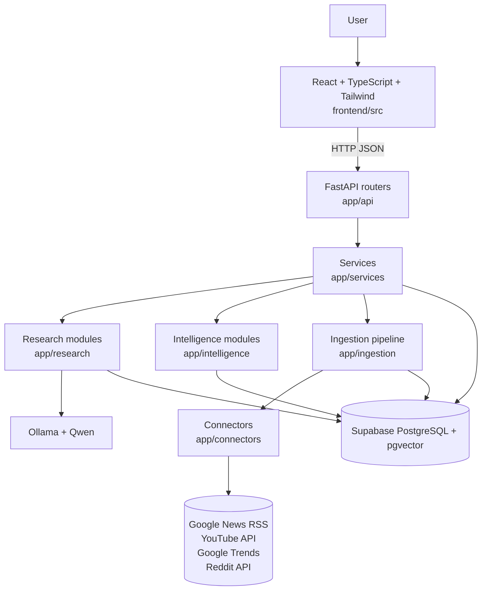
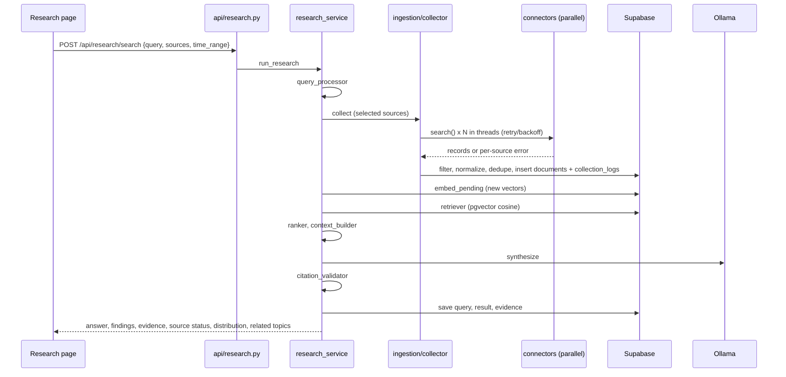
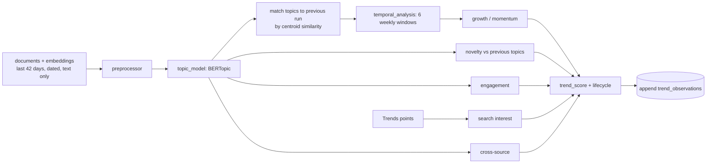
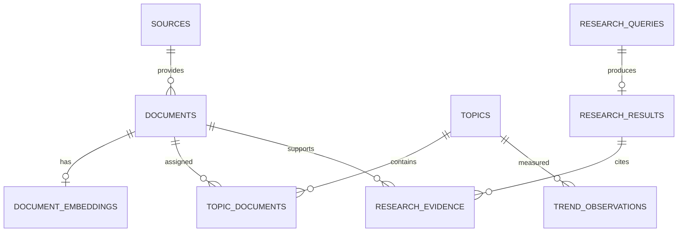

# Tratepra V1: Product Requirements and Implementation Guide

Version 1.0 · Status: code complete, unit-tested, not yet verified against live services (see section 11).

This document has two parts. **Part A (sections 1-4)** is the PRD: what we are building and why. **Part B (sections 5-12)** is the implementation guide: which file does what, **what connects to what**, and how to run it.

---

# Part A: Product Requirements

## 1. Product summary

Tratepra is an AI research and trend-intelligence platform. A user asks a question; Tratepra pulls evidence from several sources, writes a cited answer, discovers topics in the collected data, and scores which topics are emerging, with every number traceable to stored observations.

**Differentiator.** An ordinary AI search tool retrieves and summarises. Tratepra also (1) finds semantically related topics, (2) measures topic activity over time, (3) computes an explainable Trend Score, and (4) links every result back to original evidence.

## 2. Users and problems

| User | Problem | What Tratepra gives them |
| --- | --- | --- |
| Analyst / researcher | Checking news, video and community sources by hand is slow | One query across sources, with citations they can click |
| Founder / product lead | Hard to tell a real trend from one loud week | Growth, momentum and coverage shown per topic, with history |
| Student / builder (demo audience) | Needs a reproducible, explainable system | Documented formulas, stored observations, visible source failures |

## 3. Scope

**In scope (V1):** three modules (AI Research Engine, Trend Intelligence Engine, Research Dashboard), four connectors (Google News, YouTube, Google Trends, Reddit), Supabase/PostgreSQL + pgvector, Ollama + Qwen, single-user local mode.

**Out of scope (V1):** MCP, autonomous agents, content generation, extra integrations, authentication, Collections, Kafka/Kubernetes/Redis/Celery, a separate vector DB, microservices.

## 4. Functional requirements and status

Status key: **Done** = implemented and covered by unit tests or build checks. **Done, unverified live** = implemented, but needs a real database/LLM/API key to prove. **Gap** = not built.

### 4.1 AI Research Engine

| ID | Requirement | Status |
| --- | --- | --- |
| R1 | Accept a natural-language query, a source selection and a time range | Done |
| R2 | Retrieve from each selected connector independently and in parallel | Done (parallelism tested with fakes) |
| R3 | Normalise to one record format; keep `None` for missing fields | Done |
| R4 | Filter by date window; report undated records instead of inventing dates | Done |
| R5 | Remove duplicates (id, canonical URL, hash, near-duplicate) | Done |
| R6 | Rank by `R = 0.45S + 0.25K + 0.20F + 0.10Q` | Done (weights are untuned heuristics) |
| R7 | Generate a grounded answer with Ollama/Qwen | Done, unverified live |
| R8 | Remove citations that point to nothing | Done |
| R9 | Persist query, answer and evidence; reopen from History | Done, unverified live DB |
| R10 | Show source failures to the user | Done |

### 4.2 Trend Intelligence Engine

| ID | Requirement | Status |
| --- | --- | --- |
| T1 | Preprocess text (clean, length, language guard, duplicates) | Done (language check is an ASCII heuristic) |
| T2 | Embeddings stored in pgvector | Done, unverified live |
| T3 | BERTopic with UMAP + HDBSCAN, seeded, noise handled | Done, unverified on real data |
| T4 | Weekly activity per topic over consistent windows | Done |
| T5 | Growth with zero-baseline safeguard; momentum from consecutive windows | Done |
| T6 | Novelty vs earlier topic centroids; engagement; search interest; cross-source | Done |
| T7 | Trend Score `0.30G+0.20M+0.15E+0.15N+0.10S+0.10C`, missing signals renormalised, withheld below 50% coverage | Done |
| T8 | Lifecycle: emerging / growing / peaking / declining, configurable thresholds | Done (needs tuning on real data) |
| T9 | Append-only history; never overwrite old scores | Done |
| T10 | Evaluate topic quality and score behaviour on real data | **Gap**: needs a real collected dataset |

### 4.3 Dashboard

| ID | Requirement | Status |
| --- | --- | --- |
| D1 | Home, Research, Trends, Trend detail, Saved, History (+ Settings) | Done |
| D2 | Every metric comes from the backend | Done |
| D3 | Loading, empty and error states | Done |
| D4 | Clickable citations; source status; source distribution | Done |
| D5 | Charts from real observations | Done |
| D6 | Works on desktop and mobile | Done (screenshot-checked) |

### 4.4 Cross-cutting

| ID | Requirement | Status |
| --- | --- | --- |
| X1 | Credentials stay on the backend | Done |
| X2 | Unavailable connectors are shown as unavailable; no simulated data | Done |
| X3 | Internal endpoints protected by a token | Done |
| X4 | Supabase as managed database | Done, unverified live |

### 4.5 Success criteria (release candidate)

The end-to-end demo in `DEMO_GUIDE.md` works: Home shows real metrics, a query returns a cited answer with source status, topics are found from collected data, a trend page shows score, components, history and coverage, and a saved result appears in Saved and History.

### 4.6 Risks

| Risk | Effect | Mitigation |
| --- | --- | --- |
| Reddit commercial-use permission | Cannot use Reddit data in a paid product | Connector reports "unavailable" until approved; verify terms before launch |
| Google Trends API is an alpha | Search-interest signal may be missing | Isolated provider; score renormalises without it; endpoint is a placeholder |
| YouTube search quota (100 units/call) | Quota runs out | 6-hour cache, quota counter, quota errors surfaced |
| Few documents / short history | No topics, noisy growth | Minimum 20 documents; sparse and zero baselines flagged; score withheld when coverage is low |
| Untuned weights | Rankings and scores are heuristics | Documented as experimental; weights are config values |
| Local LLM unavailable | No synthesized answer | Labelled extractive fallback; never invents sources |

---

# Part B: Implementation Guide

## 5. Architecture at a glance



**One shared data pipeline, two intelligence modules.** Connectors and ingestion fill the `documents` table once. The Research Engine and the Trend Engine both read from it. They never call each other's internals; they meet only in the database (and in two small places noted in section 7.4).

**Two separate execution paths:**
- **Live research** runs when a user submits a query (`POST /api/research/search`).
- **Trend analysis** is a batch job over everything collected so far (`scripts.run_trend_analysis` or `POST /api/internal/trends/recompute`). Run it periodically; each run adds a new snapshot.

## 6. Module map: every backend file and what it connects to

Imports are read from the code. "Used by" shows who calls the file.

### 6.1 `app/core`: shared foundation (everything depends on this)

| File | Responsibility | Used by |
| --- | --- | --- |
| `config.py` | All settings from `.env` (DB, Ollama, keys, ranking weights, trend weights, thresholds) | Almost every module |
| `database.py` | Engine, `SessionLocal`, `get_db`, `init_db`, `normalize_database_url` (Supabase-ready) | `main.py`, routers, services, scripts, models |
| `exceptions.py` | `ConnectorError` (kinds: error, quota, rate_limit, auth, unavailable) and `require_internal_token` | connectors, resilience, collector, `api/internal.py` |
| `logging.py` | Log setup | `main.py`, scripts |

### 6.2 `app/connectors`: the four sources (leaf modules)

| File | Source | Auth | Notes |
| --- | --- | --- | --- |
| `base.py` | Common interface `BaseConnector.search(query, time_range)`, `make_record`, `parse_time_range`, shared `_request` | n/a | `_request` delegates to `ingestion/resilience.py` |
| `google_news.py` | Google News RSS | none | Parsed with `feedparser`; missing dates stay `None` |
| `youtube.py` | YouTube Data API v3 | API key | Search plus statistics; 6-hour cache; quota counter |
| `google_trends.py` | Official API if key present, else optional `pytrends` | access-dependent | Produces search-interest points, not articles |
| `reddit.py` | Reddit Data API | OAuth client credentials | Needs app registration and approval |
| `__init__.py` | Registry `CONNECTOR_CLASSES`, `get_connector`, `all_connectors` | n/a | The only place the collector learns which connectors exist |

Every connector returns the same record shape: `source, external_id, title, description, url, published_at, collected_at, engagement, metadata`.

### 6.3 `app/ingestion`: the shared pipeline

| File | Responsibility | Connects to |
| --- | --- | --- |
| `resilience.py` | Timeouts, exponential backoff, `Retry-After`, no retry on auth/quota | Called by `connectors/base.py` |
| `collector.py` | `fetch_sources` (parallel threads) then `persist_outcome` (single-thread DB writes); `collect()` | Uses connectors, filters, normalizer, deduplicator, models |
| `filters.py` | Date window; counts out-of-window and undated | Collector |
| `normalizer.py` | Clean text, canonical URL, content hash, document dict | Collector |
| `deduplicator.py` | Batch and stored dedup (id, URL, hash, token-Jaccard within a source) | Collector |
| `embedding_store.py` | Embeds documents that have no vector yet and saves them | Research service, internal API, scripts |

`NON_TEXT_SOURCES = {"google_trends"}` is defined in `collector.py`. Trends rows are stored but excluded from retrieval, embeddings and topic modelling.

### 6.4 `app/research`: the AI Research Engine (called in this order)

| Step | File | Input → output |
| --- | --- | --- |
| 1 | `query_processor.py` | Raw question → keywords, intent, time range |
| 2 | `retriever.py` | Query embedding → nearest stored documents (pgvector cosine), filtered by source and time |
| 3 | `ranker.py` | Candidates → ranked list using `R = 0.45S + 0.25K + 0.20F + 0.10Q` |
| 4 | `context_builder.py` | Ranked list → top evidence (per-source cap), numbered `[1]..[n]` |
| 5 | `synthesizer.py` | Evidence → answer + key findings via Ollama (extractive fallback if down) |
| 6 | `citation_validator.py` | Answer → same answer with unsupported `[n]` removed |

### 6.5 `app/intelligence`: the Trend Intelligence Engine

| File | Responsibility |
| --- | --- |
| `embeddings.py` | Sentence-transformer model, `embed_texts`, `embed_query` (shared with Research) |
| `preprocessor.py` | Clean, length filter, English guard, duplicate text |
| `topic_model.py` | BERTopic (UMAP → HDBSCAN → c-TF-IDF), seeded |
| `topic_representations.py` | Topic names, centroids, nearest topics (shared with Research for "related topics") |
| `temporal_analysis.py` | Window edges, per-window counts, search-interest signal |
| `growth.py`, `momentum.py` | Growth with zero-baseline safeguard; momentum from two consecutive growths |
| `novelty.py`, `engagement.py` | Novelty vs earlier topics; engagement percentile across topics |
| `trend_score.py` | Weighted score, renormalised over available signals, withheld below coverage minimum |
| `lifecycle.py` | Emerging / growing / peaking / declining from window volumes |

### 6.6 `app/services`: orchestration (the glue)

| File | Orchestrates |
| --- | --- |
| `research_service.py` | `run_research`: process query → collect → embed → retrieve → rank → context → synthesize → validate → save. Also `serialize_result` |
| `trend_service.py` | `recompute`: load documents → preprocess → BERTopic → windows → signals → score → lifecycle → save observations. Also `list_trends`, `trend_detail`, `trend_history` |
| `dashboard_service.py` | Home metrics (counts, average score, trending, recent activity), reusing `trend_service.list_trends` |
| `saved_service.py`, `history_service.py` | Saved items and research history |
| `source_service.py` | Registers sources on startup; connector availability for the UI |

### 6.7 `app/api`, `app/models`, `scripts`

| Area | Files | Role |
| --- | --- | --- |
| API routers | `research.py`, `trends.py`, `dashboard.py`, `sources.py`, `saved.py`, `history.py`, `internal.py` | Thin HTTP layer; each calls one service |
| Models | `models/entities.py` | All tables (section 8) |
| Schemas | `schemas/__init__.py` | Pydantic request/response shapes |
| Scripts | `collect_data.py`, `process_documents.py`, `run_trend_analysis.py` | Command-line entry points for collection, embedding, trend runs |
| App | `main.py` | Creates the app, CORS, startup (`init_db`, `ensure_sources`), mounts routers |

## 7. Connectivity: what works with what

### 7.1 Dependency layers

Dependencies point downward only. A layer never imports from a layer above it.

```
Frontend pages ──HTTP──▶ api/ ──▶ services/ ──▶ research/ , intelligence/ , ingestion/
                                                        │              │            │
                                                        └──────────────┴────┬───────┘
                                                                            ▼
                                                               connectors/  +  models/ + core/
```

### 7.2 Which connector feeds which engine

| Connector | Stored as | Research Engine | Trend Engine |
| --- | --- | --- | --- |
| Google News | text documents | retrieval, ranking, citations | topic modelling, volume windows, cross-source count |
| YouTube | text documents + views/likes/comments | same | same, plus **engagement** signal |
| Reddit | text documents + score/comments | same | same, plus **engagement** signal |
| Google Trends | search-interest points (not text) | **not used** | **search-interest signal only** |

So the engines share three text connectors fully, and Google Trends feeds one Trend Score component (10% weight). If Trends or Reddit is unavailable, the app still works and the score renormalises.

### 7.3 Flow A: live research query



Notes on connectivity in this flow:
- Each query triggers a **live collection**, so new documents are stored and become part of the history the Trend Engine later analyses.
- `related_topics` comes from stored topic centroids, so it is empty until a trend run has happened.
- Source status shown in the UI is the per-connector result returned by the collector.

### 7.4 Flow B: trend analysis (batch)



Notes:
- Needs at least 20 usable documents, otherwise it reports `insufficient_documents`.
- Windows are rebuilt from each document's `published_at`, so results are only meaningful if collection covered those weeks.
- The Trend Engine reuses `intelligence/embeddings.py` and `topic_representations.py`; the Research Engine reuses the same two for query embedding and related topics. Those are the only shared intelligence code.
- Matching a topic to its previous run keeps the same topic id, so its history chart continues.

### 7.5 Flow C: dashboard reads

Each frontend page calls specific endpoints through `src/services/*.ts`:

| Page | Calls | Backend service |
| --- | --- | --- |
| Home | `GET /api/dashboard/overview`, `GET /api/sources` (search box) | `dashboard_service`, `source_service` |
| Research | `POST /api/research/search`, `GET /api/research/{id}`, `GET /api/sources`, `POST /api/saved` | `research_service`, `saved_service` |
| Trends | `GET /api/trends?lifecycle&q&min_sources` | `trend_service.list_trends` |
| Trend detail | `GET /api/trends/{id}`, `GET /api/trends/{id}/history`, `POST /api/saved` | `trend_service` |
| Saved | `GET`, `DELETE /api/saved` | `saved_service` |
| History | `GET /api/research/history` | `history_service` |
| Settings | `GET /api/sources` | `source_service` |

The time-range dropdown in the top bar is shared state (`hooks/useRange.tsx`); the search box reads it when submitting.

## 8. Data model and table connectivity



| Table | Written by | Read by |
| --- | --- | --- |
| `sources` | startup, collector (last status/error) | research ranker (quality prior), Settings page |
| `documents` | collector | retriever, trend service, evidence display |
| `document_embeddings` | `embedding_store` | retriever, trend service |
| `topics`, `topic_documents` | trend service | trend pages, related topics |
| `trend_observations` (append-only) | trend service | trends list, detail, history, Home |
| `research_queries`, `research_results`, `research_evidence` | research service | Research page, History |
| `saved_items` | saved service | Saved page |
| `collection_logs` | collector | `GET /api/internal/collection/status` |

The Research and Trend engines are connected **only through `documents`, `document_embeddings` and `topics`**. Research writes documents (through live collection) that Trends later reads; Trends writes topic centroids that Research later reads for related topics.

## 9. Configuration

All settings live in `.env` (template: `.env.example`) and are loaded by `core/config.py`.

| Group | Variables | Notes |
| --- | --- | --- |
| Database | `DATABASE_URL`, `DB_POOL_SIZE`, `DB_MAX_OVERFLOW` | Supabase URL accepted as copied; SSL added automatically |
| LLM | `OLLAMA_BASE_URL`, `OLLAMA_MODEL` | Default model `qwen3.5:4b` |
| Embeddings | `EMBEDDING_MODEL`, `EMBEDDING_DIM` | Dimension must match the model (384 for MiniLM) |
| Connectors | `YOUTUBE_API_KEY`, `REDDIT_CLIENT_ID/SECRET/USER_AGENT`, `GOOGLE_TRENDS_API_KEY`, `GOOGLE_TRENDS_ALLOW_FALLBACK` | Missing → connector shows "not configured" |
| Internal API | `INTERNAL_API_TOKEN` | Change from `change-me` |
| Frontend | `VITE_API_URL` (frontend `.env`) | Backend address |

Ranking weights, trend weights, minimum coverage, window length and lifecycle thresholds are also settings in `config.py`, so they can be tuned without code changes.

## 10. Run order (what to start, in what order)

1. **Database:** Supabase project with the `vector` extension, or the local compose override.
2. **Ollama:** `ollama pull qwen3.5:4b`.
3. **Backend:** `docker compose up --build` (or `uvicorn app.main:app`). Tables and sources are created on startup.
4. **Settings page:** confirm which connectors are available.
5. **Collect:** `python -m scripts.collect_data "AI coding agents" "LLM agents" --range 30d`.
6. **Trend run:** `python -m scripts.run_trend_analysis` (repeat daily or weekly for history).
7. **Use the app:** Home → Research → Trends → Trend detail → Save → Saved / History.

Dependencies to respect: research works after step 3 with no prior data (it collects live). Trends need step 5 first and at least 20 usable documents. Related topics and the Trends pages are empty until step 6.

## 11. Verification status and known gaps

**Verified here:** 44 unit tests on the pure logic (growth, momentum, novelty, engagement, Trend Score, lifecycle, windows, query processing, ranking, citations, dedup, filters, retries, parallel collection, URL normalisation); Python compile and app import; frontend type-check, production build and screenshots with sample data.

**Not verified here (needs your environment):** a live Supabase/Postgres with pgvector, Ollama answers, BERTopic on real documents, real connector calls with real keys, the frontend against a running backend.

**Known gaps:**
- First Alembic migration not generated (`alembic revision --autogenerate -m init`); tables are created on startup meanwhile.
- Google Trends official endpoint path is a placeholder.
- Reddit needs registration and commercial-use approval.
- Topic quality and score weights need evaluation on real data (requirement T10).
- Language detection is an ASCII heuristic.
- No authentication, no scheduled collection (run the scripts from cron or a scheduler).
- Frontend and API integration tests are not written.

## 12. Where to look for what

| Question | File |
| --- | --- |
| How is the Trend Score defined and what happens when signals are missing? | `docs/TREND_SCORING.md`, `intelligence/trend_score.py` |
| What does each API return? | `docs/API_DOCUMENTATION.md`, `schemas/__init__.py` |
| How do I set up Supabase? | `docs/SUPABASE.md` |
| What does each source need? | `docs/DATA_SOURCES.md` |
| What is built vs planned? | `docs/IMPLEMENTED_VS_PLANNED.md` |
| How do I demo it? | `docs/DEMO_GUIDE.md` |
